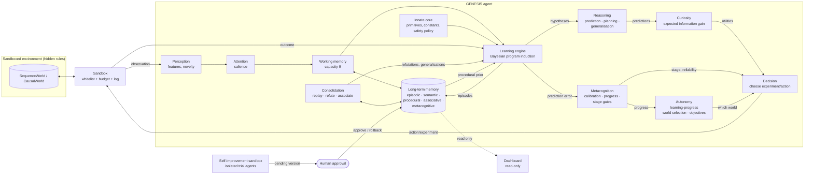

# GENESIS — Scientific and Technical Architecture

This document covers deliverables A–H of the first assignment. Deliverables I and J (the prototype and its
reproducible demonstration) are the `genesis/` package, `python -m genesis demo`, and
`python -m genesis benchmark` (results in [`RESULTS.md`](RESULTS.md)).

Notation: **innate** = present before any experience (fixed by the designers, recorded in the manifest);
**acquired** = constructed by the agent from its own episodes (recorded with provenance and evidence).

---

## A. Feasibility analysis

### What is scientifically realistic now

| Goal | Feasibility | Why |
|---|---|---|
| Discover hidden rules of small symbolic worlds from interaction, starting with only arithmetic/logic primitives | **High** – demonstrated here | Bayesian program induction over a compositional hypothesis space is well understood (Solomonoff induction, Bayesian Occam's razor, DreamCoder-style program synthesis). With small worlds the search is tractable on a CPU. |
| Curiosity that is *not* random (information-gain–driven experiments) | **High** – demonstrated here | Expected information gain over an explicit hypothesis posterior is computable exactly; it ignores unlearnable noise ("noisy-TV" immunity) because hypotheses agree there. |
| Distinguish correlation from causation | **High in sandboxed worlds** – demonstrated here | The agent can intervene (`do(state)`), so confounds in passive data can be broken by experiments (Pearl's interventional rung). |
| Persistent, auditable, non-forgetting memory | **High** for symbolic knowledge – demonstrated here | Per-context symbolic rules with provenance do not interfere with each other. This does **not** solve catastrophic forgetting in distributed neural representations. |
| Perception of raw images/audio from scratch | **Medium** | Requires learned neural encoders (PyTorch). Self-supervised representation learning works, but needs data and compute, and the learned features must be bridged to the symbolic layer. Not implemented yet. |
| Open-ended language understanding from scratch | **Low** within any reasonable budget | Humans need years of grounded multimodal experience. Without a pretrained LLM (which the spec forbids, rightly, for learning claims) this is a long-term research question, not an engineering task. |
| Unrestricted recursive self-improvement | **Deliberately excluded** | Unsafe and unmeasurable. Only bounded, validated self-tuning (priors, strategies) is allowed. |

### Core scientific bets

1. **Learning = constructing programs that predict experience.** The agent's knowledge is a set of small
   programs (rules) composed from innate primitives, scored by a Bayesian posterior (Occam prior × likelihood).
   This makes learning *measurable* (prediction accuracy on unseen data), *inspectable* (rules are readable) and
   *honest* (each rule cites the episodes that induced, supported or refuted it).
2. **Prediction error drives everything.** Surprise triggers re-induction; forward (out-of-sample) prediction
   success is required before a belief is called validated; the metacognitive layer tracks calibration.
3. **Curiosity = expected information gain** about the agent's own hypotheses, plus a decaying novelty bonus.
4. **Developmental gating.** Stages are unlocked by measured performance (curriculum gates), not time.
5. **Start symbolic and small; add neural modules only when a measured need appears** (e.g. raw perception).

### Main risks (see also §H)

- Combinatorial explosion of the hypothesis space (mitigated: observational-equivalence pruning, budgets, size
  limits; open: library learning / abstraction).
- The hypothesis space is an inductive bias chosen by the designers. Rules outside it (e.g. requiring
  division or loops) cannot be learned yet; the agent then reports them as *unpredictable* rather than inventing
  an answer.
- Black-swan induction: a rule can be validated before the evidence that would refute it has appeared
  (observed once on a decrementing modular counter before wrap-around; see §H).
- Noise robustness of conditional rules is limited (exact branch matching).

---

## B. Cognitive architecture

| Module | File | Scientific principle | Status |
|---|---|---|---|
| Innate core | `innate.py` | Core-knowledge hypothesis (Spelke): minimal domain-general primitives; explicit innate/acquired split | implemented |
| Perception engine | `perception.py`, `adapters.py` | Feature extraction, novelty as inverse familiarity (habituation) | implemented (numeric/symbolic); neural encoders planned |
| Working memory | `memory.py: WorkingMemory` | Limited capacity (Miller/Cowan), salience × recency decay eviction | implemented |
| Long-term memory | `memory.py: LongTermMemory` | Multiple memory systems (Tulving/Squire): episodic, semantic, procedural, associative, metacognitive | implemented (SQLite) |
| Attention engine | `attention.py` | Salience from novelty, surprise and reward (Itti & Baldi "Bayesian surprise") | implemented |
| Learning engine | `induction.py`, `expressions.py` | Bayesian program induction; Occam prior; online posterior update; prediction-error–triggered re-induction | implemented |
| Reasoning engine | `induction.py` (induction), `agent.py` (deduction via rule application, BFS planning), `consolidation.py` (generalisation, causal vs spurious) | Hypothetico-deductive cycle; means-end planning | implemented (basic) |
| Curiosity engine | `curiosity.py` | Intrinsic motivation as information gain (Schmidhuber, Oudeyer, active learning / optimal experiment design) | implemented |
| Decision engine | `agent.py: live`, `adapters.py` | Utility maximisation over candidate experiments/actions; planning over learned model | implemented |
| Metacognitive engine | `metacognition.py` | Calibration (Brier, ECE), learning progress, knowing-what-you-don't-know | implemented |
| Consolidation engine | `consolidation.py` | Systems consolidation / hippocampal replay during sleep (McClelland et al. CLS) | implemented |
| Environments + sandbox | `environments/` | Controlled micro-worlds with hidden, seed-sampled rules | implemented (sequences, causal lab) |
| Developmental curriculum | `metacognition.py: CURRICULUM` | Piaget-inspired staged development with measurable gates | stages 0–7 gated |
| Autonomous exploration | `autonomy.py: Explorer` | Learning-progress–driven allocation (Oudeyer & Kaplan, intelligent adaptive curiosity); self-generated objectives | implemented (stage 6) |
| Self-improvement | `self_improvement.py` | Bounded, reproducible A/B evaluation of allowlisted parameters on trial + holdout seeds; human approval; rollback | implemented (stage 7) |
| Observability | `dashboard.py` | Read-only inspection of memory; every element traceable to DB rows (`explain`) | implemented (stdlib HTTP + vanilla JS) |

## C. Module diagram

### The 12-step cycle (`Genesis.live`)

1. **Observe** – the adapter enumerates candidate situations (streams to sample, experiments to run).
2. **Perceive** – features + novelty signature (`Perception`).
3. **Remember** – recent context from working memory, falling back to long-term memory.
4. **Predict** – each relevant learner's predictive distribution.
5. **Explore** – curiosity utility = EIG + novelty + review-due bonus.
6. **Act** – execute the highest-utility situation through the sandbox (or random / round-robin for controls).
7. **Observe outcome**.
8. **Compare** – correctness, surprise (bits), calibration record.
9. **Learn** – posterior update; re-induction on surprise.
10. **Store** – episode (before learning, so knowledge can cite it), learner state.
11. **Consolidate** – every 50 interactions and at session end.
12. **Adapt** – spaced-review schedule, procedural prior, budget-aware focus (finish the cheapest open problem
    when the budget cannot cover all of them), idle stop when nothing is left to learn. Across worlds, the
    `Explorer` (stage 6) decides where the next 10 interactions go; across versions, stage 7 proposes
    configuration changes that a human must approve.

### Interfaces

- **World → agent:** only through `Sandbox.call(method, ...)`; whitelisted methods per world (`AGENT_METHODS`).
  Hidden members (`_rules`, `_true_next`, `_future`, …) are reachable only by the evaluation harness; a test
  statically checks that agent code never references them.
- **Adapter protocol** (`adapters.py`): `candidates() -> [Situation]` (each with the learner `Query`s it
  informs), `execute(situation) -> Outcome`, `after(situation, outcome)`, `var_names(key)`. New environments plug
  in via a new adapter.
- **Learner protocol** (`RuleLearner`): `observe(inputs, y, episode_id) -> LearnResult`, `predict(inputs) ->
  Prediction`, `best()`, `status()`, `to_state()/from_state()`.
- **Memory API** (`LongTermMemory`): `record_episode`, `upsert_knowledge`, `add_evidence`, `explain(id)`,
  `record_shape`, `upsert_association`, `record_metric`, `checkpoint/restore`.

### Data structures

- `Expr(op, args, value)` – immutable program tree; `shape()` abstracts variables/constants for procedural memory.
- `Hypothesis(expr, log_prior, n_ok, n_bad, fwd_ok, fwd_bad, born_n, probe_sig)` – `fwd_*` count predictions made
  *before* seeing the outcome (true out-of-sample evidence).
- `Prediction(value, confidence, p_null, distribution, hypothesis)`.
- `KnowledgeItem(id, key, kind, statement, expr, confidence, status, provenance, context, ts, ...)`.
- Episodes: `(id, session, ts, env_id, context, provenance ∈ {observation, experiment, goal-directed}, action,
  observation, prediction, outcome, error, surprise)`.

---

## D. Initial knowledge specification

Recorded verbatim at birth in `meta.innate_manifest` (with a SHA-256 digest; the agent refuses to wake if it
changes) and audited in `meta.stage0_audit`.

| Innate (given) | Not given (must be acquired) |
|---|---|
| Integer `add`, `sub`, `mul`, `mod` (positive modulus) | Any rule of any environment |
| `eq`, `if_eq` (conditional selection) | Which variables matter, which are noise |
| Constants 0, 1, 2, 3 | Larger constants (e.g. 7, 5, −2) – proposed from data |
| Mechanisms: enumeration of compositions, Occam prior, likelihood, surprise, novelty counts, reward signal, working/long-term memory | Concepts, categories, causal associations, which actions do what |
| Safety policy (frozen) | Which rule *shapes* tend to work (procedural memory) |
| | Whether something is learnable at all (judged "unpredictable" from evidence) |

Stage-0 audit checks (all must pass): empty memory, `domain_knowledge == []`, `pretrained_models == []`, no
learners. No pretrained model, embedding, dataset or LLM is used anywhere.

## E. Learning algorithms per developmental stage

| Stage | Algorithm(s) | Gate to pass (measured) |
|---|---|---|
| 0 Initialization | Manifest + audit | `stage0_audit_passed ≥ 1` |
| 1 Pattern discovery | Online Bayesian program induction over sequence features `x[t-1..3], t`; on-manifold rollout probes define behavioural equivalence; curiosity selects which stream to sample | extrapolation accuracy on 10 unseen terms ≥ 0.8 and false-validation rate on noise ≤ 0.05 |
| 2 Relationships & associations | Same induction over object properties; frame generalisation ("action a can only change {…}"); contrast-based associations Δ = P(change\|q=v) − P(change\|q≠v) | passive prediction accuracy on natural events ≥ 0.8 |
| 3 Causal discovery | Interventional experiments chosen by expected information gain; conditional rules `if q==c then e1 else e2`; one-variable-change experiment designs; association labelled *causal* only if the interventional contrast survives | held-out accuracy ≥ 0.95 on unseen configurations, and every confounded rule's true cause identified |
| 4 Memory & knowledge | Persistence, consolidation/replay, refutation tracking, spaced review | retention after reload ≥ 0.99, forgetting after a new world ≤ 0.02 |
| 5 Reasoning | Forward simulation with learned rules + breadth-first planning to unseen goals | planning success ≥ 0.9 |
| 6 Autonomous exploration | Learning-progress allocation of 10-interaction chunks across worlds (2 probe chunks each, then progress + 0.1/√chunks optimism; stop when no world shows progress ≥ 0.05); knowledge gaps → stored objectives | knowledge gain vs round-robin ≥ 0.02 and noise share ≤ 0.25 |
| 7 Continuous development | One-parameter variants of allowlisted settings, evaluated in isolated agents on trial then holdout seeds (strict gain, no extra false validations); human approval; self-identified limitations | evaluation reproducible, safety policy unchanged, no holdout regression, ≥ 1 limitation identified |

Details of the core learner (`RuleLearner`):

- **Prior:** `−2·ln(size) − ln N(size)` (N = number of distinct programs of that size) + procedural bonus
  `shape_bias·ln(1+successes(shape))`; conditionals pay `−ln(#conditions) − ln 4`.
- **Likelihood:** `(1−ε)` if the program predicts the observation, `ε/R` otherwise. A **null hypothesis**
  ("unpredictable", uniform over R outcomes) competes with every program.
- **Proposal:** bottom-up enumeration with observational-equivalence pruning; constants proposed from data
  (frequent values, differences, ratios, contrasts, max+1) besides innate ones; bias fitting (e + r).
- **Validation:** equivalence-class posterior ≥ 0.9 **and** ≥ 4 correct forward predictions **and** ≤ 10%
  forward errors. **Unpredictable:** p(null) ≥ 0.9 with ≥ 8 observations.
- **Re-induction** on surprise with exponential backoff; previously proposed hypotheses keep their statistics.
- **Curiosity:** EIG of the next observation about the hypothesis variable; novelty bonus `1/(1+n)`; resolved
  questions are revisited on a spaced schedule (10, 20, 40 interactions, then graduate).

## F. Persistent memory model (SQLite, `memory.py`)

| Table | Memory system | Key fields |
|---|---|---|
| `episodes` | Episodic | session, ts, env, context, provenance (observation/experiment/goal-directed), action, observation, prediction, outcome, error, surprise |
| `knowledge` + `knowledge_history` | Semantic | key, kind (rule/meta/generalisation), statement, expr, confidence, status (candidate/validated/dormant/refuted/unpredictable), provenance, context, timestamps; every status change is logged |
| `evidence` | Provenance links | knowledge_id ↔ episode_id with relation induced_from / supports / contradicts / refuted_by |
| `procedures` | Procedural | rule shape → successes / failures (biases future induction) |
| `associations` | Associative | a, b, kind (correlational/causal/spurious/inconclusive), weight, n, contrast details |
| `metacog` | Metacognitive | session, metric, value, context (calibration, replay consistency, assessments) |
| `learner_state` | Model state | serialised learners (data, hypotheses, statistics) to resume across sessions |
| `meta` | Identity | innate manifest + digest, safety digest, stage-0 audit, session counter, review schedule |

Consolidation never deletes episodes; refuted beliefs are kept with their refuting evidence.
`checkpoint()` / `restore()` provide rollback.

## G. First artificial learning environments

1. **SequenceWorld(seed)** – 10 integer streams. 8 follow rules sampled from the seed across families: arithmetic,
   geometric, additive recurrence, period-2/3, quadratic in t, modular counter, lag-2 arithmetic. 2 are pure
   noise. The agent may only call `stream_ids()` and `next_term(sid)`; it chooses which stream to sample.
2. **CausalWorld(seed)** – 4 objects' properties `p0..p3 ∈ {0..5}` and 4 actions. Each action has a hidden rule
   (add / set / copy / sum), possibly gated by a condition `if pq == c`. At least one condition is
   **confounded** in passive observation (another property mirrors the true cause), so watching alone cannot
   identify the cause. Agent-callable methods: `spec`, `passive_observation`, `experiment(state, action)`,
   `begin_task`, `act`.

Rules are sampled per seed, so they cannot be hard-coded. External information sources are not connected; any
future source must be tagged with provenance `external` and kept separate from experience.

## H. Implementation roadmap and risks

### Roadmap

| Phase | Content | Acceptance criterion |
|---|---|---|
| 1 ✅ | Innate core, induction, memory, curiosity, metacognition, consolidation, sequence + causal worlds, benchmarks, demo | stages 0–5 gates pass on held-out seeds |
| 2 | **Noise-robust rules**: stochastic likelihoods for conditionals, probabilistic transitions | ≥ 0.9 held-out accuracy at 5% observation noise |
| 3 (partial ✅) | **Library learning** (DreamCoder-style): promote recurring validated sub-programs to new primitives | measurable reduction in observations-to-validation on new worlds vs no library. *Done so far:* library-first search over remembered shapes cuts search 16.7×; observations unchanged; sub-program promotion still open |
| 4 ✅ | **Stage 6**: multi-world autonomy, learning-progress–based world selection, self-generated goals | beats round-robin world allocation in knowledge per interaction (met at budget 150 and 300; **not** at 100) |
| 5 | **Neural perception** (PyTorch, CPU): self-supervised encoders for grid images/audio emitting discrete symbols to the learner | rule discovery in a pixel-rendered CausalWorld within 2× the symbolic sample count |
| 6 ✅ | **Stage 7 / self-improvement sandbox**: the agent proposes config variants (priors, budgets), evaluated on frozen benchmark seeds in a copy of memory; promoted only after human approval | improvement on held-out seeds, safety digest unchanged |
| 7 ✅ | **Observability service**: read-only API over the memory DB + dashboard (stage, curves, beliefs, `explain`). Built with stdlib `http.server` + vanilla JS instead of FastAPI/React: no measured need yet justifies the dependencies | every dashboard element traceable to DB rows |
| 8 | Simulated physics world; text interaction grounded in learned concepts | defined when phase 5 is complete |

Dependencies are added only when their phase begins and a measured need justifies them (PyTorch at phase 5;
FastAPI/React only if the stdlib dashboard becomes insufficient; Docker when there are services to orchestrate).

### Risks

| Risk | Impact | Mitigation |
|---|---|---|
| Search explosion for larger rules | cannot learn | budgets (candidates, seconds) in the safety policy; library learning (phase 3) |
| Inductive black swan (validated too early) | false knowledge | forward-validation, spaced review, refutation tracking; residual risk documented |
| Designer bias in the hypothesis space | "learning" limited to what designers anticipated | explicit manifest; report "unpredictable" honestly; expand primitives only via documented versions |
| Benchmark overfitting during development | inflated results | report held-out seeds (100–109) not used during development |
| Symbolic-neural bridge | perception may not yield usable symbols | phase 5 has its own measurable criterion |
| Unsafe self-modification | loss of control | frozen safety digest; self-improvement only in sandbox + human approval |

### Known limitations of the current prototype

- Hypothesis space: integer arithmetic/logic, size ≤ 5 (sequences) or ≤ 3 + one conditional (lab).
- Conditional rules require exact branch matches (not noise-tolerant).
- Modulus constants are found heuristically (max+1, differences); an unusual modulus may be missed.
- Zero forgetting is a property of per-context symbolic knowledge, not a general solution to catastrophic
  forgetting.
- Equivalence for sequence rules is judged on rollouts of the current best rule (on-manifold), so two rules that
  agree on the trajectory but differ elsewhere are treated as the same belief.
- Stage 6 allocation needs ≥ 2 probe chunks per world, so it loses to round-robin when the budget is very small
  (100 interactions for 4 worlds).
- Stage 7 tunes only a few allowlisted parameters; most have no measurable effect, and the confirmed gain so far
  is small (+0.007 on holdout). It cannot change algorithms or architecture.
- Curiosity spends slightly more observations on noise than round-robin.
- Neural perception is not implemented yet.
