# GENESIS — Scientific and Technical Architecture

This document covers deliverables A–H of the first assignment. Deliverables I and J (the prototype and its
reproducible demonstration) are the `genesis/` package, `python -m genesis demo`, and
`python -m genesis benchmark` (results in [`RESULTS.md`](RESULTS.md)).

Notation: **innate** = present before any experience (fixed by the designers, recorded in the manifest);
**acquired** = constructed by the agent from its own episodes (recorded with provenance and evidence).

---

## A. Feasibility analysis

### What is scientifically realistic now

| Goal | Feasibility | Why |
|---|---|---|
| Discover hidden rules of small symbolic worlds from interaction, starting with only arithmetic/logic primitives | **High** – demonstrated here | Bayesian program induction over a compositional hypothesis space is well understood (Solomonoff induction, Bayesian Occam's razor, DreamCoder-style program synthesis). With small worlds the search is tractable on a CPU. |
| Curiosity that is *not* random (information-gain–driven experiments) | **High** – demonstrated here | Expected information gain over an explicit hypothesis posterior is computable exactly; it ignores unlearnable noise ("noisy-TV" immunity) because hypotheses agree there. |
| Distinguish correlation from causation | **High in sandboxed worlds** – demonstrated here | The agent can intervene (`do(state)`), so confounds in passive data can be broken by experiments (Pearl's interventional rung). |
| Persistent, auditable, non-forgetting memory | **High** for symbolic knowledge – demonstrated here | Per-context symbolic rules with provenance do not interfere with each other. This does **not** solve catastrophic forgetting in distributed neural representations. |
| Perception of raw images/audio from scratch | **Medium** | Requires learned neural encoders (PyTorch). Self-supervised representation learning works, but needs data and compute, and the learned features must be bridged to the symbolic layer. Not implemented yet. |
| Open-ended language understanding from scratch | **Low** within any reasonable budget | Humans need years of grounded multimodal experience. Without a pretrained LLM (which the spec forbids, rightly, for learning claims) this is a long-term research question, not an engineering task. |
| Unrestricted recursive self-improvement | **Deliberately excluded** | Unsafe and unmeasurable. Only bounded, validated self-tuning (priors, strategies) is allowed. |

### Core scientific bets

1. **Learning = constructing programs that predict experience.** The agent's knowledge is a set of small
   programs (rules) composed from innate primitives, scored by a Bayesian posterior (Occam prior × likelihood).
   This makes learning *measurable* (prediction accuracy on unseen data), *inspectable* (rules are readable) and
   *honest* (each rule cites the episodes that induced, supported or refuted it).
2. **Prediction error drives everything.** Surprise triggers re-induction; forward (out-of-sample) prediction
   success is required before a belief is called validated; the metacognitive layer tracks calibration.
3. **Curiosity = expected information gain** about the agent's own hypotheses, plus a decaying novelty bonus.
4. **Developmental gating.** Stages are unlocked by measured performance (curriculum gates), not time.
5. **Start symbolic and small; add neural modules only when a measured need appears** (e.g. raw perception).

### Main risks (see also §H)

- Combinatorial explosion of the hypothesis space (mitigated: observational-equivalence pruning, budgets, size
  limits; open: library learning / abstraction).
- The hypothesis space is an inductive bias chosen by the designers. Rules outside it (e.g. requiring
  division or loops) cannot be learned yet; the agent then reports them as *unpredictable* rather than inventing
  an answer.
- Black-swan induction: a rule can be validated before the evidence that would refute it has appeared
  (observed once on a decrementing modular counter before wrap-around; see §H).
- Noise robustness of conditional rules is limited (exact branch matching).

---

## B. Cognitive architecture

| Module | File | Scientific principle | Status |
|---|---|---|---|
| Innate core | `innate.py` | Core-knowledge hypothesis (Spelke): minimal domain-general primitives; explicit innate/acquired split | implemented |
| Perception engine | `perception.py`, `adapters.py` | Feature extraction, novelty as inverse familiarity (habituation) | implemented (numeric/symbolic); neural encoders planned |
| Working memory | `memory.py: WorkingMemory` | Limited capacity (Miller/Cowan), salience × recency decay eviction | implemented |
| Long-term memory | `memory.py: LongTermMemory` | Multiple memory systems (Tulving/Squire): episodic, semantic, procedural, associative, metacognitive | implemented (SQLite) |
| Attention engine | `attention.py` | Salience from novelty, surprise and reward (Itti & Baldi "Bayesian surprise") | implemented |
| Learning engine | `induction.py`, `expressions.py` | Bayesian program induction; Occam prior; online posterior update; prediction-error–triggered re-induction | implemented |
| Reasoning engine | `induction.py` (induction), `agent.py` (deduction via rule application, BFS planning), `consolidation.py` (generalisation, causal vs spurious) | Hypothetico-deductive cycle; means-end planning | implemented (basic) |
| Curiosity engine | `curiosity.py` | Intrinsic motivation as information gain (Schmidhuber, Oudeyer, active learning / optimal experiment design) | implemented |
| Decision engine | `agent.py: live`, `adapters.py` | Utility maximisation over candidate experiments/actions; planning over learned model | implemented |
| Metacognitive engine | `metacognition.py` | Calibration (Brier, ECE), learning progress, knowing-what-you-don't-know | implemented |
| Consolidation engine | `consolidation.py` | Systems consolidation / hippocampal replay during sleep (McClelland et al. CLS) | implemented |
| Environments + sandbox | `environments/` | Controlled micro-worlds with hidden, seed-sampled rules | implemented (sequences, causal lab) |
| Developmental curriculum | `metacognition.py: CURRICULUM` | Piaget-inspired staged development with measurable gates | stages 0–7 gated |
| Autonomous exploration | `autonomy.py: Explorer` | Learning-progress–driven allocation (Oudeyer & Kaplan, intelligent adaptive curiosity); self-generated objectives | implemented (stage 6) |
| Self-improvement | `self_improvement.py` | Bounded, reproducible A/B evaluation of allowlisted parameters on trial + holdout seeds; human approval; rollback | implemented (stage 7) |
| Innate language faculty | `language.py` | Hand-written FR/EN lexicon about the agent itself + grammatical cues → `Parse` (language, concepts, question type, negation, unknown topic words, typo corrections). Like the arithmetic primitives, it is given, declared and audited, not learned. No pretrained model | implemented (59 + 38 test sentences, see RESULTS) |
| Entry point (chat) | `chat.py`, `chat_server.py` | Interaction channel: the innate language faculty's parse is mapped to an intent that routes user input to the cycle (`live` on user-provided sequences) or to memory queries (`explain`, knowledge, stage, limitations, curiosity gaps). Unknown sentences are taught by the user and learned as word→command associations (`lexicon.py`, cross-situational learning; Siskind 1996, Yu & Smith 2007), executed autonomously only after validation by confirmed predictions | implemented (no LLM; stdlib HTTP + vanilla JS, ChatGPT-style UI, persistent conversations) |
| Semantic teaching | `semantic.py` | Explicit membership, inclusion and location; conditional forward inference with premise IDs, conflict blocking, correction history and conversational references | implemented, empty at birth; external teachings stay unverified |
| Grounded representation learning | `grounding.py` | Minimal consistent sensor projections, learned action-relative groups, forward checks and one-channel contrasts; revised on incompatible repeated states | implemented as a bounded object experiment, not general language grounding |
| Observability | `dashboard.py` | Read-only inspection of memory; every element traceable to DB rows (`explain`) | implemented (stdlib HTTP + vanilla JS) |

## C. Module diagram

```mermaid
flowchart LR
    subgraph World["Sandboxed environment (hidden rules)"]
        W[(SequenceWorld / CausalWorld)]
    end
    SB[Sandbox<br/>whitelist + budget + log]
    W <--> SB

    subgraph Agent["GENESIS agent"]
        IN[Innate core<br/>primitives, constants,<br/>safety policy]
        PER[Perception<br/>features, novelty]
        ATT[Attention<br/>salience]
        WM[Working memory<br/>capacity 9]
        LTM[(Long-term memory<br/>episodic · semantic ·<br/>procedural · associative ·<br/>metacognitive)]
        LRN[Learning engine<br/>Bayesian program induction]
        RSN[Reasoning<br/>prediction · planning ·<br/>generalisation]
        CUR[Curiosity<br/>expected information gain]
        DEC[Decision<br/>choose experiment/action]
        META[Metacognition<br/>calibration · progress ·<br/>stage gates]
        CON[Consolidation<br/>replay · refute · associate]
        EXP[Autonomy<br/>learning-progress<br/>world selection · objectives]
    end
    SI[Self-improvement sandbox<br/>isolated trial agents]
    HUM([Human approval])
    DASH[Dashboard<br/>read-only]
    CHAT([Chat entry point<br/>command grammar · no LLM])
    GROUND[Grounded explorer<br/>learned sensor projections]
    WORDS[Grounded lexicon<br/>competing word meanings]

    SB -- observation --> PER --> ATT --> WM
    WM <--> LTM
    WM --> LRN
    IN --> LRN
    LRN -- hypotheses --> RSN
    RSN -- predictions --> CUR
    CUR -- utilities --> DEC
    DEC -- action/experiment --> SB
    SB -- outcome --> LRN
    LRN -- prediction error --> META
    LRN -- episodes --> LTM
    META -- stage, reliability --> DEC
    CON <--> LTM
    CON -- refutations, generalisations --> LRN
    LTM -- procedural prior --> LRN
    META -- progress --> EXP
    EXP -- which world --> DEC
    SI -- pending version --> HUM
    HUM -- approve / rollback --> LTM
    LTM -. read only .-> DASH
    CHAT -- user-provided sequences --> SB
    CHAT <-- explain · knowledge · gaps --> LTM
    CHAT -- object annotations --> WORDS
    WORDS <-- observations · learned effects --> GROUND
    GROUND <-- experiments --> SB
    GROUND <--> LTM
    WORDS <--> LTM
```

### The 12-step cycle (`Genesis.live`)

1. **Observe** – the adapter enumerates candidate situations (streams to sample, experiments to run).
2. **Perceive** – features + novelty signature (`Perception`).
3. **Remember** – recent context from working memory, falling back to long-term memory.
4. **Predict** – each relevant learner's predictive distribution.
5. **Explore** – curiosity utility = EIG + novelty + review-due bonus.
6. **Act** – execute the highest-utility situation through the sandbox (or random / round-robin for controls).
7. **Observe outcome**.
8. **Compare** – correctness, surprise (bits), calibration record.
9. **Learn** – posterior update; re-induction on surprise.
10. **Store** – episode (before learning, so knowledge can cite it), learner state.
11. **Consolidate** – every 50 interactions and at session end.
12. **Adapt** – spaced-review schedule, procedural prior, budget-aware focus (finish the cheapest open problem
    when the budget cannot cover all of them), idle stop when nothing is left to learn. Across worlds, the
    `Explorer` (stage 6) decides where the next 10 interactions go; across versions, stage 7 proposes
    configuration changes that a human must approve.

### Interfaces

- **World → agent:** only through `Sandbox.call(method, ...)`; whitelisted methods per world (`AGENT_METHODS`).
  Hidden members (`_rules`, `_true_next`, `_future`, …) are reachable only by the evaluation harness; a test
  statically checks that agent code never references them.
- **Adapter protocol** (`adapters.py`): `candidates() -> [Situation]` (each with the learner `Query`s it
  informs), `execute(situation) -> Outcome`, `after(situation, outcome)`, `var_names(key)`. New environments plug
  in via a new adapter.
- **Learner protocol** (`RuleLearner`): `observe(inputs, y, episode_id) -> LearnResult`, `predict(inputs) ->
  Prediction`, `best()`, `status()`, `to_state()/from_state()`.
- **Memory API** (`LongTermMemory`): `record_episode`, `upsert_knowledge`, `add_evidence`, `explain(id)`,
  `record_shape`, `upsert_association`, `record_metric`, `checkpoint/restore`.

### Data structures

- `Expr(op, args, value)` – immutable program tree; `shape()` abstracts variables/constants for procedural memory.
- `Hypothesis(expr, log_prior, n_ok, n_bad, fwd_ok, fwd_bad, born_n, probe_sig)` – `fwd_*` count predictions made
  *before* seeing the outcome (true out-of-sample evidence).
- `Prediction(value, confidence, p_null, distribution, hypothesis)`.
- `KnowledgeItem(id, key, kind, statement, expr, confidence, status, provenance, context, ts, ...)`.
- Episodes: `(id, session, ts, env_id, context, provenance ∈ {observation, experiment, goal-directed}, action,
  observation, prediction, outcome, error, surprise)`.

---

## D. Initial knowledge specification

Recorded verbatim at birth in `meta.innate_manifest` (with a SHA-256 digest; the agent refuses to wake if it
changes) and audited in `meta.stage0_audit`.

| Innate (given) | Not given (must be acquired) |
|---|---|
| Integer `add`, `sub`, `mul`, `mod` (positive modulus) | Any rule of any environment |
| `eq`, `if_eq` (conditional selection) | Which variables matter, which are noise |
| Constants 0, 1, 2, 3 | Larger constants (e.g. 7, 5, −2) – proposed from data |
| Mechanisms: enumeration of compositions, Occam prior, likelihood, surprise, novelty counts, reward signal, working/long-term memory | Concepts, categories, causal associations, which actions do what |
| Safety policy (frozen) | Which rule *shapes* tend to work (procedural memory) |
| | Whether something is learnable at all (judged "unpredictable" from evidence) |
| Bilingual FR/EN language faculty (`language.py`): ~350 word forms about GENESIS itself → ~30 concepts, grammar cues (elision, contraction, interrogatives, inversion, negation, stemming, one-typo tolerance) | Any meaning outside that vocabulary (slang, jargon, world topics) – taught by the user (`lexicon.py`) |
| Symbolic teaching grammar and conditional class inheritance (`semantic.py`, declared in the language manifest) | Named entities, membership, inclusion and spatial relations; no example facts are installed at birth |
| Bounded predictive feature abstraction (`grounding.py`, separate `innate_grounding` manifest) | Relevant channels, projected groups, effect tables and empirical validation evidence |
| Sensor/effect predicate space and conjunction/local-negation grammar (`grounded_language.py`, declared in `innate_grounding`) | All object-word meanings, acquired through external examples linked to experiments |

The language faculty is recorded separately in `meta.innate_language` (own digest, version, session installed);
a designer upgrade is allowed but logged in `meta.innate_language_history`. It is interface knowledge, not world
knowledge: `language.audit()` rejects digits, rule vocabulary (`WORLD_TERMS`: "plus", "double", "modulo",
"fibonacci", "arithmetic"...) and environment terms (the tests feed it the hidden rule families and kinds).

Stage-0 audit checks (all must pass): empty memory, `domain_knowledge == []`, `pretrained_models == []`, no
learners, language faculty free of world knowledge. No pretrained model, embedding, dataset or LLM is used anywhere.

### Semantic teaching and reasoning

`SemanticDialogue.respond(cid, text, lang)` runs before command/lexical routing. A full-match, bounded grammar
produces `Fact(subject, relation, object, negative)` values. Supported relations are instance membership,
universal class inclusion and location. The grammar distinguishes assertions from questions; only whole,
supported teaching messages are stored. Several assertions can be separated by periods or semicolons.
References resolve to one conversational subject stored in message metadata; ambiguous references ask for a name.

`SemanticMemory.teach` records an external teaching episode and a `knowledge(kind="semantic")` row using the
existing evidence/history tables. All premises are `user-taught`, never `observation` or `validated`. The schema's
numeric confidence is fixed at 0.5 as an **uncalibrated placeholder**, not an empirical probability; the UI labels
it unverified. Repeating a claim adds provenance, not confidence. Prior agreement is recorded before teaching,
but an error here means disagreement with a user assertion, not an independently measured factual error.

`answer(Fact)` performs bounded forward closure over active inclusion rules. From `x instance A` and
`A subclass B`, it may infer `x instance B`; it never confuses an instance with a universal rule, infers the
converse, or assumes arbitrary relations to be transitive. Missing evidence yields `unknown`, not false.
Opposite premises yield `conflict`; conflicting intermediates are excluded from further propagation. Stable ID
ordering and a visited-class set give deterministic, cycle-safe proofs. Each query records its premise IDs and
statements in an `inference` episode.

Explicit corrections/refutations preserve original teachings and history. Conclusions are computed on demand,
not stored as independent truths, so retracting an inclusion rule immediately invalidates its downstream answers.
Knowledge survives restarts; dialogue subjects are scoped to conversations. A hard limit of 512 distinct
assertion/polarity pairs bounds closure without silently evicting knowledge. This is a deliberately small,
inspectable symbolic learner, not a model of human memory or an open-domain language system.

## E. Learning algorithms per developmental stage

### Object-grounded word acquisition

`GroundedLexicon` connects a taught word to sensor readings or experimentally observed action effects,
not to a command name. The learner maintains a version space of simple meanings: "sensor X equals V" or
"action A produces V". This hypothesis language and the FR/EN sentence frames are innate; word meanings are
not. Positive/negative examples eliminate incompatible meanings. Equivalent meanings can remain ambiguous;
agreement on an object permits a tentative prediction, not a claim that the ambiguity is resolved.

Teaching episodes must retain both the external annotation and the observed object/effect evidence. Validation
requires correct predictions made before new annotations, on distinct sensor configurations; repetition is not
validation. Queries on unseen objects may use validated learned effect predictions, while teaching uses actual recorded
experiments. An effect-model revision requires lexical revalidation. Contradictory annotations are retained;
only an explicit correction supersedes the earlier annotation.

Acceptance criteria: no preloaded word meanings; transfer to new object IDs and irrelevant sensor values;
composition of independently learned words with conjunction and local negation; abstention for unknown words or
unsupported effects; retained evidence, corrections and reload behavior. A simulated teacher is harness-only.
These are tests of constrained lexical grounding, not learned grammar or human-level general comprehension.

`ObjectDialogue` routes explicit workshop sentences before semantic teaching and ordinary command parsing.
The CLI supplies a sandbox factory; the language module never imports a concrete world or reads hidden rules.
`meta["object-dialogue/<conversation>"]` retains the selected specimen/world, while
`meta["grounded-language/<environment>"]` retains examples and validation signatures.
`knowledge(kind="grounded-word")` links external annotation episodes and actual experiment episodes, with
`supports` reserved for prior predictions on novel configurations. A word needs three correct future checks,
no failures for its current interpretation, and both positive/negative labels. Equally compatible meanings
can remain unresolved even when predictions validate. Confidence is empirical annotation agreement, not truth.

Fixed bounds are 64 words, 512 annotations and 128 candidate predicates per world, and four terms per query.
Changing any action revision conservatively invalidates all words in that world, including sensory words.
Explicit corrections require renewed checks if the meaning changes; original annotations remain available.
This lexical module alone learns no syntax; translation, noisy-label models, relational word induction and
visual perception remain unsupported.

### Induced sentence constructions

`constructions.py` adds supervised flat construction induction, not general grammar acquisition. Given a
sentence paired with a conjunction of signed, already grounded word predicates, it aligns each target word
with its unique occurrence and replaces it with a numbered slot. Literal tokens, slot order and the polarity
assigned to each slot are learned from demonstrations. Tokenization, alignment, substitution, conjunction and
Boolean negation are the declared innate mechanisms; the initial construction inventory is empty.

`ConstructionLearner.teach` records its interpretation **before** incorporating a demonstration. A form needs
three correct prior predictions on new binding tuples and at least two different words in every slot.
Contradictory assignments or overlapping forms with different meanings cause abstention. Corrections deactivate
earlier demonstrations of that sentence, retain original episodes and reset prospective validation. Queries
never fit. Only validated constructions can select objects, through the existing grounded lexicon's validation
gates. They cannot invoke actions, change safety policy, or override explicit workshop commands.

`meta["constructions/<environment>"]` stores examples and validation state, never `learner_state`.
`knowledge(kind="construction")` exposes learned forms, status history and annotation evidence. Mechanism
installation is versioned inside the grounding manifest, preserving the frozen core birth manifest.
Bounds: 256 demonstrations, 64 forms, 24 alphabetic tokens per sentence and four distinct target words.
Multiword lexical units, recursion, morphology, missing arguments and general semantic parsing are unsupported.
Grammar survives effect-model revisions, but execution still requires currently grounded word meanings.

Acceptance: no supplied forms; exact interpretation and object selection for untrained word bindings;
retention on reload; no validation from repetition; abstention on unknown or conflicting forms; no fitting on
held-out sentences/objects. The teacher supplies meanings using the explicit interface grammar. This acquires
small interpretation programs, **not the learning algorithm or a general reasoning mechanism**.

### Grounded object experiment: predictive abstractions

The next experiment learns a **representation**, not just a sentence-to-command mapping. Objects expose opaque
integer sensor channels and opaque actions. The agent observes effects only after acting on disposable simulated
specimens. The simulator samples hidden action laws; neither relevant channels nor object categories are supplied
to the learner.

The selected CPU-only mechanism is predictive feature abstraction: enumerate bounded subsets of observed sensor
channels, retain those consistent with experience, and prefer the smallest. Objects sharing a projected state are
tentatively equivalent *for predicting an action's effect*. The number of groups and their memberships are learned.
This is a categorical representation learner, not a neural model and not a claim that the innate subset-search
bias was itself learned. It is compared with the existing symbolic `RuleLearner`, full-state lookup, object-ID
lookup and a majority-outcome baseline using the same training transitions.

Experiments are chosen using competing abstractions' disagreement/unknown predictions, novelty and controlled
one-channel contrasts. Predictions precede outcomes. Candidate concepts require future successful predictions on
new full sensor configurations and intervention evidence before validation. An incompatible repeated full state
starts a new action-model revision, preserving the old episodes; this is a deterministic-world revision policy,
not a reliable change detector in stochastic worlds.

Acceptance criteria: abstain before experience; at least 90% accuracy on unseen object IDs with new distractor
values; exceed rote lookup coverage; demonstrate one-action goal selection from the learned model; retain answers
after reload and learning another environment; recover after a hidden rule change. Report all failures and
baselines, not just averages. Held-out effects must never enter fitting or experiment selection.

Technical risks: the smallest consistent feature subset can be spurious under confounding; novel relevant values
require abstention, not extrapolation; feature-subset search is exponential and must be capped; pure outcome
equivalence is task-relative, not human semantics. There is no open-domain language learning, physical realism,
pretrained model or autonomous modification of safety constraints in this experiment.

Implementation: `GroundedExplorer(agent, sandbox)` reads only the observation/action schema and specimen catalog.
`Projection` searches subsets in increasing size and preserves ambiguity between equally small consistent models.
`predict(features, action)` abstains when models disagree or lack the projected input; `choose_action` uses the
learned effects for a one-step goal. `run(steps)` prioritizes uncertainty, novelty and one-channel changes.
The benchmark also runs `strategy="random"` at the same budgets; no superiority is assumed.

`meta["grounding/<environment>"]` retains training transitions, action-specific revisions and forward-validation
state. `knowledge(kind="grounded-concept")` stores representations with ordinary episode evidence and status
history. Validation needs four correct future predictions on new full configurations, a unique minimal
projection and contrasting intervention evidence for every retained feature. Confidence is the observed forward
success fraction, not a calibrated probability. Old revisions are refuted, not erased; no learned parameters or
experiences are added to the frozen core innate manifest. Mechanism installation/upgrades are recorded separately
in `innate_grounding` / `innate_grounding_history`, preserving old database compatibility.

Fixed bounds are eight sensors, four actions, 64 candidate specimens and 512 retained experimental transitions
per world, in addition to the existing agent/sandbox interaction budgets. The current simulator uses five binary
training sensors and two actions; held-out irrelevant sensors take a new value. The harness alone accesses
hidden rules for scoring, which is not an additional training channel. The last report is stored as
`grounded_evaluation` and shown on the read-only dashboard.

| Stage | Algorithm(s) | Gate to pass (measured) |
|---|---|---|
| 0 Initialization | Manifest + audit | `stage0_audit_passed ≥ 1` |
| 1 Pattern discovery | Online Bayesian program induction over sequence features `x[t-1..3], t`; on-manifold rollout probes define behavioural equivalence; curiosity selects which stream to sample | extrapolation accuracy on 10 unseen terms ≥ 0.8 and false-validation rate on noise ≤ 0.05 |
| 2 Relationships & associations | Same induction over object properties; frame generalisation ("action a can only change {…}"); contrast-based associations Δ = P(change\|q=v) − P(change\|q≠v) | passive prediction accuracy on natural events ≥ 0.8 |
| 3 Causal discovery | Interventional experiments chosen by expected information gain; conditional rules `if q==c then e1 else e2`; one-variable-change experiment designs; association labelled *causal* only if the interventional contrast survives | held-out accuracy ≥ 0.95 on unseen configurations, and every confounded rule's true cause identified |
| 4 Memory & knowledge | Persistence, consolidation/replay, refutation tracking, spaced review | retention after reload ≥ 0.99, forgetting after a new world ≤ 0.02 |
| 5 Reasoning | Forward simulation with learned rules + breadth-first planning to unseen goals | planning success ≥ 0.9 |
| 6 Autonomous exploration | Learning-progress allocation of 10-interaction chunks across worlds (2 probe chunks each, then progress + 0.1/√chunks optimism; stop when no world shows progress ≥ 0.05); knowledge gaps → stored objectives | knowledge gain vs round-robin ≥ 0.02 and noise share ≤ 0.25 |
| 7 Continuous development | One-parameter variants of allowlisted settings, evaluated in isolated agents on trial then holdout seeds (strict gain, no extra false validations); human approval; self-identified limitations | evaluation reproducible, safety policy unchanged, no holdout regression, ≥ 1 limitation identified |

Details of the core learner (`RuleLearner`):

- **Prior:** `−2·ln(size) − ln N(size)` (N = number of distinct programs of that size) + procedural bonus
  `shape_bias·ln(1+successes(shape))`; conditionals pay `−ln(#conditions) − ln 4`.
- **Likelihood:** `(1−ε)` if the program predicts the observation, `ε/R` otherwise. A **null hypothesis**
  ("unpredictable", uniform over R outcomes) competes with every program.
- **Proposal:** bottom-up enumeration with observational-equivalence pruning; constants proposed from data
  (frequent values, differences, ratios, contrasts, max+1) besides innate ones; bias fitting (e + r).
- **Validation:** equivalence-class posterior ≥ 0.9 **and** ≥ 4 correct forward predictions **and** ≤ 10%
  forward errors. **Unpredictable:** p(null) ≥ 0.9 with ≥ 8 observations.
- **Re-induction** on surprise with exponential backoff; previously proposed hypotheses keep their statistics.
- **Curiosity:** EIG of the next observation about the hypothesis variable; novelty bonus `1/(1+n)`; resolved
  questions are revisited on a spaced schedule (10, 20, 40 interactions, then graduate).

## F. Persistent memory model (SQLite, `memory.py`)

| Table | Memory system | Key fields |
|---|---|---|
| `episodes` | Episodic | session, ts, env, context, provenance (observation/experiment/goal-directed), action, observation, prediction, outcome, error, surprise |
| `knowledge` + `knowledge_history` | Semantic | key, kind (rule/meta/generalisation), statement, expr, confidence, status (candidate/validated/dormant/refuted/unpredictable), provenance, context, timestamps; every status change is logged |
| `evidence` | Provenance links | knowledge_id ↔ episode_id with relation induced_from / supports / contradicts / refuted_by |
| `procedures` | Procedural | rule shape → successes / failures (biases future induction) |
| `associations` | Associative | a, b, kind (correlational/causal/spurious/inconclusive), weight, n, contrast details |
| `metacog` | Metacognitive | session, metric, value, context (calibration, replay consistency, assessments) |
| `learner_state` | Model state | serialised learners (data, hypotheses, statistics) to resume across sessions |
| `knowledge` (`kind=lexical`) | Learned vocabulary | `lexicon/<word>` → intent, P(intent\|word), support/contra counts, forward predictions right/wrong, status; evidence = `language` episodes (taught/confirmed/rejected) |
| `knowledge` (`kind=semantic`) | External teachings | Membership, inclusion and location; unverified source, conflict/retraction history, supporting episodes |
| `knowledge` (`kind=grounded-concept`) | Experimental abstractions | Learned sensor projections and effect groups; future prediction checks and controlled intervention evidence |
| `knowledge` (`kind=grounded-word`) | Grounded lexical hypotheses | Compatible sensor/effect predicates, external annotations, experiment provenance, novel-input prediction checks |
| `knowledge` (`kind=construction`) | Learned interpretation forms | Literal/slot patterns, signed predicates, demonstrated meanings, prospective checks; state in `meta["constructions/<env>"]` |
| `conversations` + `chat_messages` | Interaction log | conversation title/lang; messages (role, text, meta JSON with intent, knowledge id, status). Data typed by the user enters `episodes` with provenance `user-provided` (external information, distinct from own observation) |
| `meta` | Identity and bounded object models | Core/language/grounding manifests and installation histories, safety digest, stage-0 audit, session counter, review schedule; `grounding/<env>` transitions and revisions, `grounded_evaluation` report; `grounded-language/<env>` lexical state, `object-dialogue/<conversation>` selection |

Consolidation never deletes episodes; refuted beliefs are kept with their refuting evidence.
`checkpoint()` / `restore()` provide rollback.

## G. First artificial learning environments

1. **SequenceWorld(seed)** – 10 integer streams. 8 follow rules sampled from the seed across families: arithmetic,
   geometric, additive recurrence, period-2/3, quadratic in t, modular counter, lag-2 arithmetic. 2 are pure
   noise. The agent may only call `stream_ids()` and `next_term(sid)`; it chooses which stream to sample.
2. **CausalWorld(seed)** – 4 objects' properties `p0..p3 ∈ {0..5}` and 4 actions. Each action has a hidden rule
   (add / set / copy / sum), possibly gated by a condition `if pq == c`. At least one condition is
   **confounded** in passive observation (another property mirrors the true cause), so watching alone cannot
   identify the cause. Agent-callable methods: `spec`, `passive_observation`, `experiment(state, action)`,
   `begin_task`, `act`.

Rules are sampled per seed, so they cannot be hard-coded. External information sources are not connected; any
future source must be tagged with provenance `external` and kept separate from experience.

## H. Implementation roadmap and risks

### Roadmap

| Phase | Content | Acceptance criterion |
|---|---|---|
| 1 ✅ | Innate core, induction, memory, curiosity, metacognition, consolidation, sequence + causal worlds, benchmarks, demo | stages 0–5 gates pass on held-out seeds |
| 2 | **Noise-robust rules**: stochastic likelihoods for conditionals, probabilistic transitions | ≥ 0.9 held-out accuracy at 5% observation noise |
| 3 (partial ✅) | **Library learning** (DreamCoder-style): promote recurring validated sub-programs to new primitives | measurable reduction in observations-to-validation on new worlds vs no library. *Done so far:* library-first search over remembered shapes cuts search 16.7×; observations unchanged; sub-program promotion still open |
| 4 ✅ | **Stage 6**: multi-world autonomy, learning-progress–based world selection, self-generated goals | beats round-robin world allocation in knowledge per interaction (met at budget 150 and 300; **not** at 100) |
| 5 | **Neural perception** (PyTorch, CPU): self-supervised encoders for grid images/audio emitting discrete symbols to the learner | rule discovery in a pixel-rendered CausalWorld within 2× the symbolic sample count |
| 6 ✅ | **Stage 7 / self-improvement sandbox**: the agent proposes config variants (priors, budgets), evaluated on frozen benchmark seeds in a copy of memory; promoted only after human approval | improvement on held-out seeds, safety digest unchanged |
| 7 ✅ | **Observability service**: read-only API over the memory DB + dashboard (stage, curves, beliefs, `explain`). Built with stdlib `http.server` + vanilla JS instead of FastAPI/React: no measured need yet justifies the dependencies | every dashboard element traceable to DB rows |
| 8 (started) | Simulated physics world; text interaction grounded in learned concepts. *Done so far:* bilingual chat, learned word mappings, semantic teaching with conditional inference, predictive object abstractions, object-grounded word meanings and flat sentence-construction induction (see RESULTS). Ordinary commands still handle one intent; semantic messages can contain several assertions with local negation. No open-domain language learning, general syntax induction, SMS handling or realistic physics | defined when phase 5 is complete |

Dependencies are added only when their phase begins and a measured need justifies them (PyTorch at phase 5;
FastAPI/React only if the stdlib dashboard becomes insufficient; Docker when there are services to orchestrate).

### Risks

| Risk | Impact | Mitigation |
|---|---|---|
| Search explosion for larger rules | cannot learn | budgets (candidates, seconds) in the safety policy; library learning (phase 3) |
| Inductive black swan (validated too early) | false knowledge | forward-validation, spaced review, refutation tracking; residual risk documented |
| Designer bias in the hypothesis space | "learning" limited to what designers anticipated | explicit manifest; report "unpredictable" honestly; expand primitives only via documented versions |
| Benchmark overfitting during development | inflated results | report held-out seeds (100–109) not used during development |
| Symbolic-neural bridge | perception may not yield usable symbols | phase 5 has its own measurable criterion |
| Unsafe self-modification | loss of control | frozen safety digest; self-improvement only in sandbox + human approval |

### Known limitations of the current prototype

- Hypothesis space: integer arithmetic/logic, size ≤ 5 (sequences) or ≤ 3 + one conditional (lab).
- Conditional rules require exact branch matches (not noise-tolerant).
- Modulus constants are found heuristically (max+1, differences); an unusual modulus may be missed.
- Zero forgetting is a property of per-context symbolic knowledge, not a general solution to catastrophic
  forgetting.
- Equivalence for sequence rules is judged on rollouts of the current best rule (on-manifold), so two rules that
  agree on the trajectory but differ elsewhere are treated as the same belief.
- Stage 6 allocation needs ≥ 2 probe chunks per world, so it loses to round-robin when the budget is very small
  (100 interactions for 4 worlds).
- Stage 7 tunes only a few allowlisted parameters; most have no measurable effect, and the confirmed gain so far
  is small (+0.007 on holdout). It cannot change algorithms or architecture.
- Curiosity spends slightly more observations on noise than round-robin.
- Neural perception is not implemented yet.
